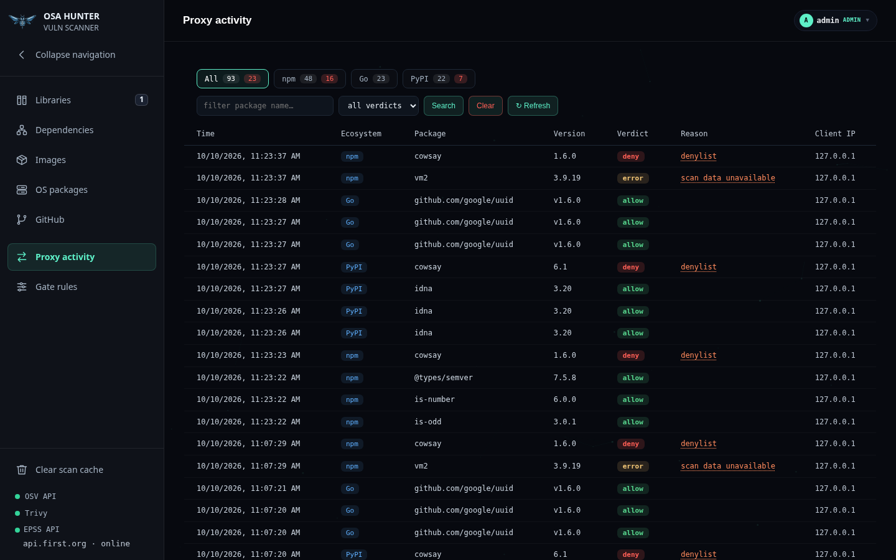
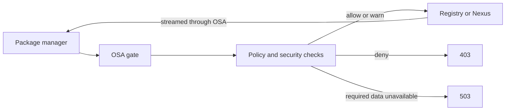
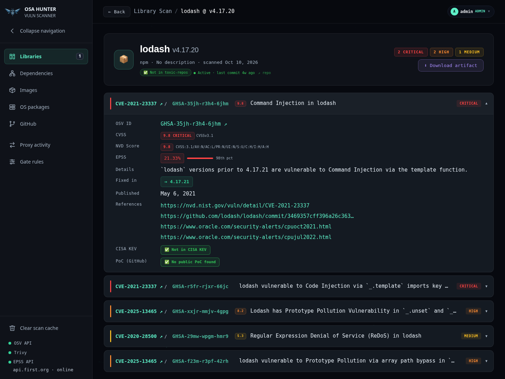

# OSA Hunter

A self-hosted package gate and vulnerability scanner.

OSA sits between package managers and their registries (directly or through
Nexus). For each artifact request it resolves the package and version, checks
them against a policy and either streams the download through or refuses it.
The same instance has a web UI for scanning packages, dependency trees,
container images, OS packages and public GitHub repositories.



## Package gate

Point a package manager at `/api/gate/<repository>/...`:



Policy rules can match on:

- package name patterns, versions and CVE IDs;
- OSV vulnerabilities and CVSS severity;
- CISA KEV (known exploited vulnerabilities);
- EPSS (exploit probability);
- public proof-of-concept exploits;
- matches in the toxic-repos feed.

Metadata requests are forwarded without scanning every published version.
Allowed archives are streamed to the client; the gate never installs or runs
packages. A policy block returns 403. With `on_gate_error: deny`, a required
check that cannot be completed returns 503 with `Retry-After`, and that
result is not cached.

Supported ecosystems: npm, PyPI, Go, Composer/Packagist, Maven, NuGet,
Cargo/crates.io, RubyGems, Debian/Ubuntu, Alpine and RPM distributions.

The [package gate guide](docs/package-gate.en.md)
([Russian](docs/package-gate.ru.md)) covers policy facts, artifact formats and
upstream mappings.

## Quick start

Requires Docker with Compose and Node.js 22+.

```bash
git clone https://github.com/ShinigamiKiko/osa-hunter.git
cd osa-hunter
node scripts/init-env.cjs --development
docker compose up --build
```

Open http://localhost:3000 and sign in as `admin` with the `ADMIN_PASSWORD`
from the generated `.env`. The script keeps an existing `.env` and does not
print credentials.

### Routing downloads through OSA

Map the repositories in `.env` first. Each one can use a registry directly or
a Nexus upstream; Nexus is optional:

```env
OSA_NEXUS_REPOSITORIES={"npm-proxy":{"ecosystem":"npm","upstream":"https://registry.npmjs.org","direct":true},"pypi-proxy":{"ecosystem":"PyPI","upstream":"https://pypi.org","direct":true},"go-proxy":{"ecosystem":"Go","upstream":"https://proxy.golang.org","direct":true}}
```

Restart the backend with `docker compose up -d backend`, then try the routes
without touching your global package manager configuration:

```bash
npm pack is-odd@3.0.1 --ignore-scripts \
  --registry=http://localhost:3000/api/gate/npm-proxy
python -m pip download --no-deps \
  --index-url http://localhost:3000/api/gate/pypi-proxy/simple \
  --trusted-host localhost idna==3.10
GOPROXY=http://localhost:3000/api/gate/go-proxy \
  go mod download github.com/google/uuid@v1.6.0
```

Production clients should use the HTTPS endpoint instead.

## Scanners

| Scanner | What it checks | Backend |
|---|---|---|
| Library | one package version | OSV, with CVSS, EPSS, CISA KEV and PoC data |
| Dependencies | the transitive dependency tree | deps.dev and OSV |
| Composer | PHP dependency resolution | Packagist |
| Container image | OS and language packages in an image | Trivy |
| OS package | Ubuntu, Debian, RHEL, Alpine and SUSE packages | Grype |
| GitHub | static analysis of a public repository | Semgrep |

Results can be exported as PDF reports.



### Toxic repositories

Packages and their source repositories can be checked against the
[toxic-repos](https://github.com/toxic-repos/toxic-repos) feed (malware,
DDoS tools, destructive code, IP blocking, political payloads). A match needs
the full repository identity or an explicit package URL; a shared repository
name alone is not enough. Enable the feed and use `toxic.found` in the policy
to act on matches; see [operations](docs/operations.md#toxic-repository-matching).

## Production

Run it behind nginx or an Ingress that terminates HTTPS:

```bash
node scripts/init-env.cjs
docker compose -f docker-compose.yml -f docker-compose.production.yml up --build -d
```

The frontend, backend and metrics ports are published on localhost only.
[deploy/production](deploy/production/README.md) has the nginx configuration,
proxy headers, credential requirements, and notes on migrating and backing up
an existing database.

## Documentation

- [Package gate](docs/package-gate.en.md): request flow, policy facts, formats, repository mappings
- [Operations and API](docs/operations.md): API examples, accounts, policy editing, Nexus, metrics, queues, caches, backups
- [Production deployment](deploy/production/README.md)
- [.env.example](.env.example): environment variables and defaults
- [policy.yaml](policy.yaml): the policy imported into PostgreSQL on first start

The active policy is stored in PostgreSQL and edited under Rules. Export it as
YAML to keep a reviewed copy in git; editing `policy.yaml` does not replace a
policy that is already in the database.

## License

[MIT](LICENSE)
